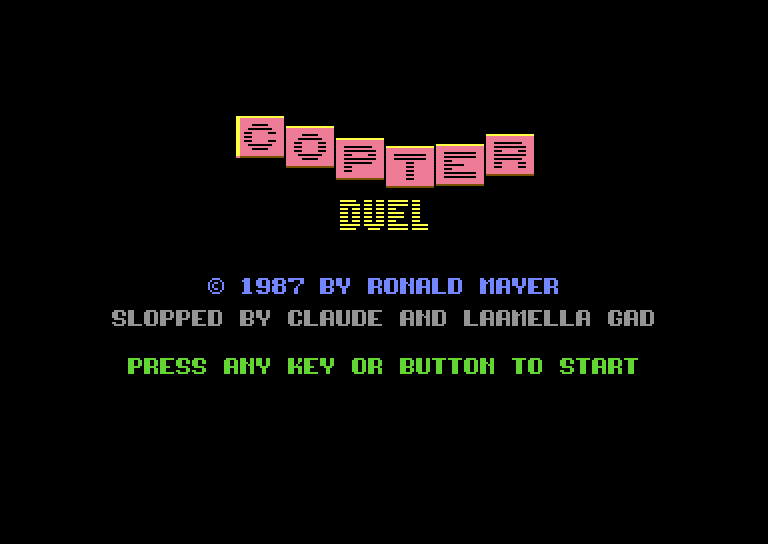
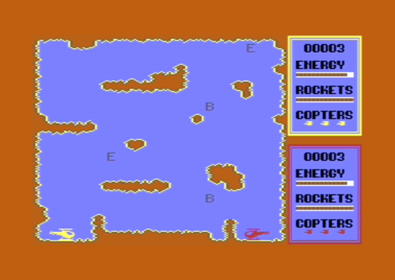
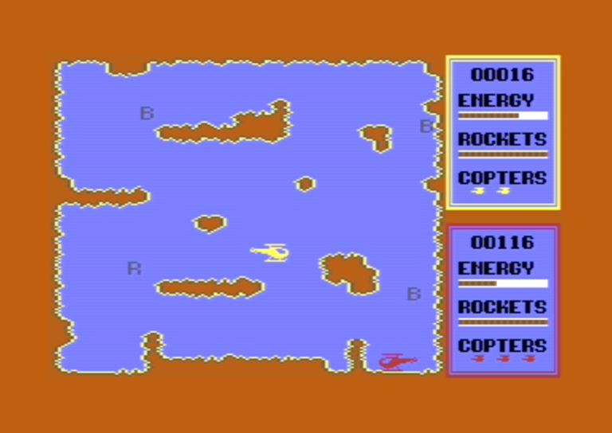
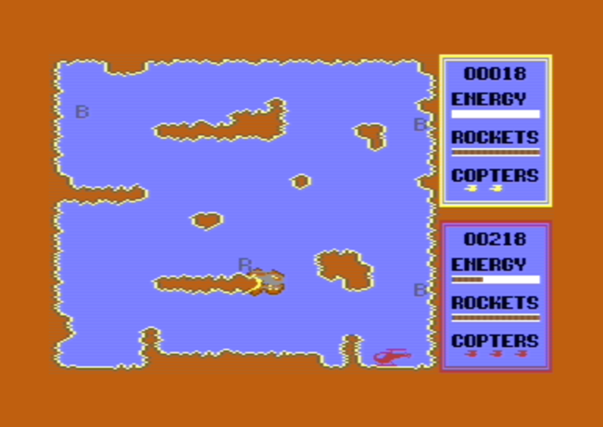

# Copter Duel Sloppy Edition

A two-player helicopter duel for the Commodore 64: yellow (joystick in port 2) and red (port 1) fight it out with
rockets in a cave.

[Download copterduel.prg](https://github.com/laamella-gad/copter_duel_sloppy_edition/raw/refs/heads/master/copterduel.prg)

| | |
|---|---|
|  |  |
| The title screen, with music and waving letters. | The start of a round: both copters on the ground. |
|  |  |
| Yellow has lost a copter, red is low on energy. | An explosion against the cave wall. |

## Bonuses

Shoot a bonus with a rocket to pick it up. The four bonuses move to new places now and then.

| Letter | Bonus                                      |
|--------|--------------------------------------------|
| B      | 10 points (twice as common as the others)  |
| R      | 14 rockets, half a bar                     |
| E      | 10 energy, a little more than a rocket hit |

## Winning

The game ends when a player loses their last copter, and the other player wins. Points only count when both lose
their last copter at the same time: then the most points win. Every crash gives the other player 100 points, whatever
caused it, and each player slowly earns points over time.

## The original

"Copter Duel" was written in 1987 by Ronald Mayer and published as "mr-soft": a BASIC program with a
machine code engine. Copter Duel Sloppy Edition is a rewrite in C for [oscar64](https://github.com/drmortalwombat/oscar64), made from a
disassembly of a tape image of the original. The tape image, the disassembly and the patched original are in the git
history up to commit 86dd7cd. `NOTES.md` has the details.

## Improvements

- The winner is decided right: the original read the end flag from the wrong address and always picked the player
  with the most points, even after a knockout.
- The copters have momentum instead of moving at a fixed speed.
- The playfield has been opened up a bit, it was too easy to crash.
- Touching the cave walls drains energy instead of crashing the copter at once.
- A rocket hit takes a third of the energy instead of crashing the copter, and the bonuses give more rockets and energy.
- Bonuses are easier to shoot: a rocket that overlaps one picks it up, with a little to spare.
- Rockets explode when they hit the cave walls.
- Crashes are more dramatic: the copter spins and flashes while it explodes, the background flashes on every explosion.
- New sounds: a whoosh when a rocket is fired, a bip when it picks up a bonus and a buzz while a copter touches
  a wall.
- The title screen plays music ("Gory Ghost") and its letters wave.
- Fixed engine quirks: copters stopped at the ground inconsistently, and rockets near the screen edges read memory
  past the screen.
- The whole program is now written in C (Oscar64 compatible)

## Building

Needs oscar64 and pucrunch; `make run` also needs VICE.

```sh
make        # copterduel.prg
make run    # build and start it in VICE
```
